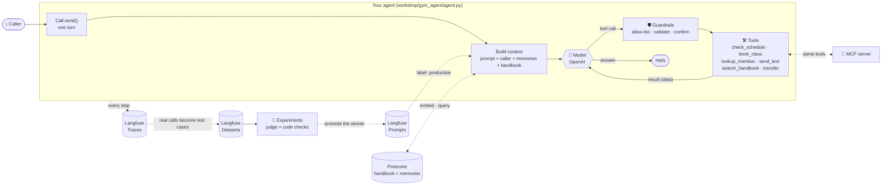

# LLM Agents Workshop

**Build a real AI agent, one piece at a time, with the tools teams use in production.**

[](https://github.com/jasonsheinkopf/LLM-Agents-Workshop/actions/workflows/ci.yml)


This is the companion repo for the **Agents Unpacked** video series. The videos explain the ideas.
This repo is where you build them, with real code against real services. Every lab is a few
focused functions, and tests tell you when they work.

---

## By the end of this workshop you will have built

An AI phone assistant for **Ridgeline Climbing Gym**, a fictional gym. A parent calls and asks:

> *"Can my 8-year-old take the belay class on Saturday? And can you book us in?"*

Your agent will:

| | It can... | Built with | Lab |
|---|---|---|---|
| 🧠 | hold a conversation, with instructions it follows | **OpenAI** chat completions | 1 |
| 🔎 | show you every step it took: prompts, retrievals, tool calls, tokens, cost, latency | **Langfuse** tracing | 2 |
| 📏 | be measured, not vibe-checked: a test set, an LLM-as-a-judge you have *calibrated*, and experiments that compare prompt versions before you ship one | **Langfuse** prompts, datasets and experiments | 3 |
| 🗄️ | answer from the gym's real handbook (RAG), and remember callers between calls | **Pinecone** vector database + OpenAI embeddings | 4 |
| 🛠️ | check the schedule, book classes and text a confirmation, with guardrails *in code*: validation, least privilege, and a confirmation step the model can't skip | OpenAI tool calling + **Pydantic** | 5 |
| 🔌 | offer its tools to *any* agent, such as Claude Desktop, Claude Code or Cursor | **MCP** (Model Context Protocol) | 6 |

You will also be able to explain each piece, and why it is there: what an agent is, why you trace
before you tune, how embeddings and retrieval work, why the model proposes and your code decides,
and how to tell whether a change made things better or worse.

> **What "done" looks like.** You run one experiment over 19 test calls. Langfuse shows the
> score of every prompt version side by side. Each answer links to a trace you can open and follow
> step by step. Then you promote the winning prompt to `production` without changing a line of code.

**This is what the course actually produces.** Every lab was run end to end on `gpt-5-mini`,
Pinecone and Langfuse on 6 Nov 2026. The scoreboard, from that run, over the same 19 calls:

| Run | Judge pass | Knowledge | Honesty | Safety | Booking |
|---|---:|---:|---:|---:|---:|
| Lab 3: prompt v1 (careful, wordy) | 0.26 | 0/8 | 2/2 | 1/1 | 1/6 |
| Lab 3: prompt v2 ("be brief") | **0.21** | 1/8 | **0/2** | **0/1** | 2/6 |
| Lab 3: prompt v3 (brief, keeps the rules) | 0.26 | 0/8 | 2/2 | 1/1 | 1/6 |
| Lab 4: v3 + memory | **0.84** | **8/8** | 2/2 | 1/1 | 3/6 |
| Lab 5: v3 + memory + tools | **0.90** | 8/8 | 2/2 | 1/1 | **5/6** |

Read the rows and you have the whole course: a prompt change that *looked* better and quietly
broke honesty and safety (v2); a fix that restores them at half the length (v3); knowledge that no
prompt could fix, fixed by memory; and bookings fixed by tools. The judge agreed with human grades
on 12 of 12 calibration answers before any of these scores were trusted.

---

## Who this is for

You've called an LLM API before (or can follow a Python function) and you want to know how a
*real* agent is built and kept honest. You don't need to have used Langfuse, Pinecone or MCP.
Each lab is a few short functions; the tests tell you when they work. If you're a leader rather
than a builder, watch the episodes and read [docs/FACILITATOR.md](docs/FACILITATOR.md) for the
90-minute version and the five questions to ask any agent team.

**Prerequisites:** Python 3.11+, git, a terminal, and about $2 of OpenAI credit. Langfuse and Pinecone have free plans.

## The series

Watch the episode, then do the lab. Each lab README starts with a link to its video.

| # | Episode | Lab: what you build | Time |
|---|---|---|---|
| 0 | *Setup* (no video) | [**Lab 0: Setup**](docs/00-setup.md). Install uv, get three API keys, pass the doctor check | 20 min |
| 1 | [What makes an agent?](https://youtube.com/@TODO) | [**Lab 1: First agent**](labs/01-first-agent/). A model, a system prompt and a conversation, and the three ways it fails | 30 min |
| 2 | [Traces: see what your agent did](https://youtube.com/@TODO) | [**Lab 2: Traces**](labs/02-traces/). Every call traced in Langfuse, grouped by phone call, with user feedback scores | 30 min |
| 3 | [Evals: how do you know it works?](https://youtube.com/@TODO) | [**Lab 3: Evals**](labs/03-evals/). Versioned prompts, a test set, an LLM-as-a-judge, experiments | 60 min |
| 4 | [Memory: where agents keep what they know](https://youtube.com/@TODO) | [**Lab 4: Memory**](labs/04-memory/). Chunk, embed and store the handbook in Pinecone; RAG; per-caller memories | 60 min |
| 5 | [Tools: how agents do things](https://youtube.com/@TODO) | [**Lab 5: Tools**](labs/05-tools/). Tool schemas, the agent loop, guardrails, a two-step booking | 60 min |
| 6 | [MCP: one plug for every tool](https://youtube.com/@TODO) | [**Lab 6: MCP**](labs/06-mcp/). Serve the tools over MCP; use them from Claude Desktop | 30 min |
| ★ | *Finale* | [**Ship it**](labs/07-ship-it/). Run the full experiment, compare, promote, and work through the production checklist | 30 min |

*Total: about 5 hours. Running cost: under $2 of OpenAI usage for the whole course with the default
`gpt-5-mini`. Langfuse and Pinecone are used on their free plans.*

---

## How the agent fits together



There is more detail in [docs/ARCHITECTURE.md](docs/ARCHITECTURE.md).

---

## Quick start

You'll need **Python 3.11+**, **git**, and a terminal. Full instructions, including how to get
each API key, are in [Lab 0](docs/00-setup.md).

```bash
# 1. Get the code and the exact dependencies (uv installs Python for you if needed)
git clone https://github.com/jasonsheinkopf/LLM-Agents-Workshop.git
cd LLM-Agents-Workshop
uv sync

# 2. Add your keys
cp .env.example .env        # then edit .env (see docs/00-setup.md)

# 3. Check everything is connected
cd workshop
uv run python -m gym_agent.doctor
```

Want to see the finished agent before you build it? Run the solution:

```bash
cd solution
uv run python -m gym_agent.memory ingest      # load the handbook into Pinecone (once)
uv run python -m gym_agent.chat               # call the gym as Dana
```

---

## How the labs work

```
workshop/   ← YOU work here. The app runs from day one; each lab fills in a few TODO(lab N) functions.
solution/   ← The finished agent. Same files and the same commands. Peek when you're stuck.
tests/      ← Offline tests (no keys, no cost). They tell you when a lab is done.
```

Each lab follows the same rhythm:

1. **Watch** the episode (5 minutes).
2. **Read** the lab README: the goal, the concepts, then numbered steps.
3. **Write** the `TODO(lab N)` functions in `workshop/gym_agent/`.
4. **Check** your code offline with `uv run pytest tests/test_labN_*.py`.
5. **Run it for real** against OpenAI, Langfuse and Pinecone, and look at what happened in the dashboards.

```bash
uv run pytest tests/test_lab1_agent.py     # check your Lab 1 code (run from the repo root)
uv run pytest                              # check all labs (later labs fail until you get there; that's expected)
uv run pytest --impl solution              # check the reference solution (all green)
grep -rn "TODO(lab3)" workshop/            # list everything Lab 3 asks you to write
diff workshop/gym_agent/memory.py solution/gym_agent/memory.py   # compare with the answer
```

> **Run commands from the right folder.** App commands (`python -m gym_agent...`) run inside
> `workshop/` (or `solution/`). Tests run from the repo root. Every lab README shows a prompt
> such as `workshop $` so you always know where you are.

---

## Repo layout

```
LLM-Agents-Workshop/
├── README.md                ← you are here
├── docs/
│   ├── 00-setup.md          ← Lab 0: uv, OpenAI, Langfuse and Pinecone keys, the doctor check
│   ├── ARCHITECTURE.md      ← how the pieces fit, and what a trace looks like
│   ├── TROUBLESHOOTING.md   ← the errors people actually hit, and their fixes
│   └── GLOSSARY.md          ← every term used in the course, in one sentence each
├── CONTRIBUTING.md          ← for maintainers: keeping workshop/ and solution/ in sync
├── labs/                    ← one README per lab: goal, concepts, steps, checks, stretch goals
│   ├── 01-first-agent/  02-traces/  03-evals/  04-memory/  05-tools/  06-mcp/  07-ship-it/
├── data/                    ← the fictional gym: handbook.md, schedule.json, callers.json
│   └── evals/               ← agent_cases.jsonl (19 test calls), judge_calibration.jsonl, retrieval_cases.jsonl
├── prompts/                 ← system_v1.md, v2, v3: the prompt versions you push to Langfuse
├── workshop/gym_agent/      ← the starter code you complete
├── solution/gym_agent/      ← the complete reference implementation
│   ├── agent.py             ← the turn: context → model → tools loop → reply (traced)
│   ├── llm.py               ← the OpenAI client (Langfuse-wrapped from Lab 2)
│   ├── prompts.py           ← fetch prompts from Langfuse by label; push and promote versions
│   ├── memory.py            ← chunk → embed → Pinecone; handbook search; per-caller memories
│   ├── tools.py             ← tool schemas and implementations (schedule, booking, member lookup, text, transfer)
│   ├── guardrails.py        ← allow-list, Pydantic validation, the confirmation rule
│   ├── mcp_server.py        ← the same tools over MCP, plus mcp_client.py to try them
│   ├── evals/               ← upload_dataset, evaluators (code + LLM judge), run_experiment, calibrate_judge, retrieval
│   ├── chat.py              ← talk to your agent in the terminal
│   └── doctor.py            ← checks your keys against the real services
├── tests/                   ← offline tests per lab (a fake model, an in-memory vector store)
├── .env.example             ← copy to .env, add your keys
└── pyproject.toml / uv.lock ← pinned dependencies (uv)
```

---

## The scenario is fictional

Ridgeline Climbing Gym, its handbook, prices, classes and callers are all invented for this course.
Phone numbers use the reserved `555-01xx` range. A climbing gym makes a good running example
because it has everything a real business agent faces: policies with exceptions (ages, waivers),
live data (seats left), actions with consequences (bookings), safety-critical handoffs (injuries),
and repeat customers worth remembering.

## When you're done: clean up

- **Pinecone:** delete the `ridgeline-agent` index in the console, or keep it, since it fits in the free plan.
- **OpenAI:** revoke the key you made for the course, if you won't use it again.
- **Langfuse:** keep the project. It's your record of everything you built.

## Credits and license

Created by [Jason Sheinkopf](https://github.com/jasonsheinkopf). Code is MIT-licensed, see
[LICENSE](LICENSE). Found a bug, or a step that confused you?
[Open an issue](https://github.com/jasonsheinkopf/LLM-Agents-Workshop/issues): that's the
fastest way to make the course better for the next person.
