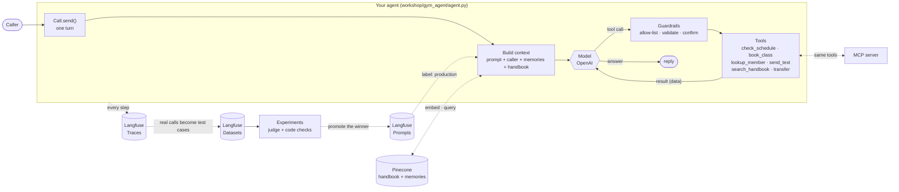

# LLM Agents Workshop

**A one-day, hands-on workshop for engineers. You arrive able to call an LLM API. You leave with
an agent you built, traced, tested and tried to break, and a plan for one of your own.**

[](https://github.com/jasonsheinkopf/LLM-Agents-Workshop/actions/workflows/ci.yml)


| | |
|---|---|
| **Format** | One day, 9:00 to 5:00, instructor-led, working in pairs |
| **Room** | 12 to 24 engineers. One instructor, plus a teaching assistant above 16 |
| **Before the day** | 30 minutes of [pre-work](#before-you-arrive) |
| **Cost per person** | Under $2 of OpenAI usage. Langfuse and Pinecone are used on their free plans |
| **On your own** | The same labs, self-paced, in about five and a half hours. See [two ways to run it](#two-ways-to-run-it) |

The whole day is built around one phone call. Ridgeline Climbing Gym, a fictional gym, wants an AI
to answer the phone, and a parent calls:

> *"Can my 8-year-old take the belay class on Saturday? And can you book us in?"*

At 9:30 your agent cannot answer that. By mid-afternoon it answers from the gym's handbook,
checks the schedule, books the right class after the caller confirms, and you have the numbers to
prove each step helped.

---

## Who this is for

Developers who have called an LLM API, or can read a Python function and change a few lines, and
who have not yet built an agent with tracing, evals and guardrails. You don't need to have used
Langfuse, Pinecone or MCP.

It is not a Python course, and it is not for people who won't write code. Leaders who decide
whether and how to use agents get a different session: the
[90-minute briefing](docs/FACILITATOR.md#variant-executive-briefing-90-minutes-no-laptops), which
uses the same agent and no laptops.

## What you will be able to do

By 5:00, every pair can do these five things. Each one has evidence you can see in the room.

| | By the end of the day you can | Shown by |
|---|---|---|
| 1 | **Build** an agent that answers from a handbook and books a class only after the caller confirms | Lab tests green on your own code, and one live booking |
| 2 | **Diagnose** a wrong answer from its trace, and name the layer that failed: prompt, knowledge, tool or model | You open one of your own bad traces and say what was missing |
| 3 | **Measure** a change before you ship it: run an experiment over 19 test calls and decide from the scores | Your scoreboard, with a regression caught and a better prompt promoted |
| 4 | **Guard** the actions that matter in code, where neither a caller nor another agent can talk past them | The red-team round: one guardrail that held, and one failure turned into a test case |
| 5 | **Transfer** the pattern to a workflow from your own job | A one-page [workflow canvas](handouts/workflow-canvas.md) with five test cases, an owner and a next step |

## What you leave with

**A working agent in your own clone of this repo**, built from six pieces:

| Block | Your agent can | Built with |
|---|---|---|
| 1 | hold a conversation, with instructions it follows | **OpenAI** chat completions |
| 2 | show you every step it took: prompts, retrievals, tool calls, tokens, cost, latency | **Langfuse** tracing |
| 3 | be measured: a test set, an LLM-as-a-judge you have calibrated, experiments that compare prompt versions | **Langfuse** prompts, datasets and experiments |
| 4 | answer from the gym's handbook (RAG), and remember callers between calls | **Pinecone** + OpenAI embeddings |
| 5 | check the schedule, book a class and text a confirmation, with guardrails in code | OpenAI tool calling + **Pydantic** |
| 6 | offer the same tools to any other agent, such as Claude Desktop or Cursor | **MCP** (Model Context Protocol) |

**A scoreboard that tells the story of the day.** You fill in your own. This one is from a full
run of the labs on `gpt-5-mini`, Pinecone and Langfuse, over the same 19 test calls:

| Run | Judge pass | Knowledge | Honesty | Safety | Booking |
|---|---:|---:|---:|---:|---:|
| Block 3: prompt v1 (careful, wordy) | 0.26 | 0/8 | 2/2 | 1/1 | 1/6 |
| Block 3: prompt v2 ("be brief") | **0.21** | 1/8 | **0/2** | **0/1** | 2/6 |
| Block 3: prompt v3 (brief, keeps the rules) | 0.26 | 0/8 | 2/2 | 1/1 | 1/6 |
| Block 4: v3 + memory | **0.84** | **8/8** | 2/2 | 1/1 | 3/6 |
| Block 5: v3 + memory + tools | **0.90** | 8/8 | 2/2 | 1/1 | **5/6** |

Read down the rows. A prompt change that felt better in chat quietly broke honesty and safety
(v2). A fix restored them at half the length (v3). Knowledge that no prompt could fix was fixed by
memory, and bookings were fixed by tools. The judge agreed with human grades on 12 of 12
calibration answers before any of these scores were trusted.

**A plan for your own work.** The [workflow canvas](handouts/workflow-canvas.md) you fill in during
the day: one workflow from your job, the knowledge and actions it needs, which actions need a human
to confirm, five test cases, what you will not automate, and who owns the next step.

---

## How the day runs

Every block runs the same loop: a short **explanation** of one idea, a live **demo** that includes
a failure, a long **build** in pairs while the instructor circulates, and a **debrief**.

| Time | Block | Explain and demo | Build | You're done when |
|---|---|---:|---:|---|
| 9:00 | Arrive and check | | | The doctor command prints three PASS lines on every laptop |
| 9:15 | **1. First agent** ([Lab 1](labs/01-first-agent/)) | 10 min | 25 min | Your tests are green, and you have watched the bare model fail to book |
| 10:00 | **2. Traces** ([Lab 2](labs/02-traces/)) | 10 min | 25 min | You open one of your own traces and find the missing fact |
| 10:45 | Break | | | |
| 11:00 | **3. Evals** ([Lab 3](labs/03-evals/)) | 15 min | 50 min | Two experiments are on screen, and the room votes which prompt to ship |
| 12:15 | Lunch | | | |
| 1:15 | **4. Memory** ([Lab 4](labs/04-memory/)) | 15 min | 50 min | Your knowledge score moved in your re-run |
| 2:30 | Break | | | |
| 2:45 | **5. Tools** ([Lab 5](labs/05-tools/)) | 15 min | 40 min | A live booking goes through the two-step confirmation |
| 3:40 | **Red-team round** ([Lab 5, part 2](labs/05-tools/#break-it-the-red-team-round)) | | 15 min | You have thrown five hostile inputs at your agent and written down what held |
| 4:00 | **6. MCP** ([Lab 6](labs/06-mcp/)) | 5 min | 12 min | Another client lists and calls your tools |
| 4:20 | **Make it yours** ([Lab 7](labs/07-ship-it/)) | | 25 min | Your workflow canvas is filled in, with an owner |
| 4:45 | Demos, exit ticket, close | | | Three pairs demo. Everyone hands in an [exit ticket](handouts/exit-ticket.md) |

About a fifth of the working day is explanation and demo, three fifths is building, and a fifth
is checking and debriefing. No explanation runs longer than 15 minutes.

**The help you get shrinks as the day goes on.** Blocks 1 and 2 are a code-along: every line is on
the page. From Block 3 the parts that carry the lesson (the graders, the retriever, the
guardrails) are described, not given, and the tests tell you when they work. The last block has no
steps at all, only an outcome.

**Nobody gets left behind, and nobody waits.** Every lab has a floor that every pair reaches, a
target most pairs reach, and a ceiling for pairs who finish early. If you fall behind,
`uv run python scripts/catch_up.py 4` gives you working code for Labs 1 to 3, so you start Lab 4
with the room.

## Before you arrive

About 30 minutes, one week before. The instructor sends [this email](handouts/pre-work-email.md).

1. **Set up your laptop** with [Lab 0](docs/00-setup.md). You are ready when
   `uv run python -m gym_agent.doctor` prints three PASS lines. This takes about 20 minutes, and
   it is the one thing that cannot wait until the day.
2. **Bring one workflow** from your own job: something repetitive or decision-heavy. One sentence
   each for what triggers it, what it needs to know, and what it produces.
3. **Answer three questions** about what you have built before, so the instructor can pair you well.
4. **Watch Episode 1** of the [recordings](#recordings) (8 minutes). It is the map for the day.

Nothing private goes into the workshop. All the data in `data/` is invented, and the
[data rule](docs/FACILITATOR.md#the-data-rule) says what may and may not be used when you adapt
the labs to your own work.

## Two ways to run it

**In a room.** The [facilitator guide](docs/FACILITATOR.md) is the run of show: what to say and
demo in each block, the failure to show on purpose, the checkpoint, the debrief questions, what to
do when a third of the laptops fail, and how to measure whether the day worked. The
[handouts](handouts/) are ready to send and print: the pre-work email, the workflow canvas, the
exit ticket and the follow-up emails.

**On your own.** Start at [Lab 0](docs/00-setup.md) and work through the labs in order. Each lab
README gives the idea, the steps, the checkpoint and the debrief questions to answer for yourself.
Budget about five and a half hours.

<a id="recordings"></a>
**Recordings.** The explanation and demo for each block are also recorded, as a six-episode
series called *Agents Unpacked* (about half an hour in total). In a room they are the instructor's
backup if a live demo fails. On your own they are the instructor.
<!-- Playlist link: replace this comment with [Watch the playlist](https://...) -->

## Why it is built this way

The design is written out in [docs/DESIGN.md](docs/DESIGN.md). In short:

1. **It starts from the outcomes.** The five outcomes above were fixed first. Every block exists
   to produce one of them, and topics that don't (fine-tuning, multi-agent orchestration,
   deployment) are left out.
2. **It teaches only enough to act.** One idea per block, and the concept before the library: you
   write the agent loop yourself before any framework would hide it.
3. **Everyone is building within 25 minutes**, and keeps building: floor, target and ceiling in
   every lab, pairs, and a catch-up command.
4. **Failure is planned.** The bare model fails in Block 1. The prompt that feels better scores
   worse in Block 3. The red-team round exists to break what you built.
5. **It measures what you built.** Tests are the checkpoint for every lab, the scoreboard is the
   evidence for the day, and the workshop itself is measured before, during, at the end and thirty
   days later.
6. **It ends with an owner.** Nobody leaves with only a demo. They leave with a canvas that names
   who does what next.

---

## Quick start

You'll need **Python 3.11+**, **git**, and a terminal. Full instructions, including how to get
each API key, are in [Lab 0](docs/00-setup.md).

```bash
# 1. Get the code and the exact dependencies (uv installs Python for you if needed)
git clone https://github.com/jasonsheinkopf/LLM-Agents-Workshop.git
cd LLM-Agents-Workshop
uv sync

# 2. Add your keys
cp .env.example .env        # then edit .env (see docs/00-setup.md)

# 3. Check everything is connected
cd workshop
uv run python -m gym_agent.doctor
```

Want to see the finished agent before you build it? Run the solution:

```bash
cd solution
uv run python -m gym_agent.memory ingest      # load the handbook into Pinecone (once)
uv run python -m gym_agent.chat               # call the gym as Dana
```

## How the labs work

```
workshop/   ← YOU work here. The app runs from the start; each lab fills in a few TODO(lab N) functions.
solution/   ← The finished agent. Same files and the same commands. Compare when you're stuck.
tests/      ← Offline tests (no keys, no cost). They tell you when a lab is done.
```

Each lab README has the same parts, in the same order: the goal, the checkpoint (floor, target and
ceiling), the idea in two minutes, the steps, a real run against OpenAI, Langfuse and Pinecone,
what to notice, the debrief questions, and one row of your workflow canvas to fill in.

```bash
uv run pytest tests/test_lab1_agent.py     # check your Lab 1 code (run from the repo root)
uv run pytest                              # check all labs (later labs fail until you get there; that's expected)
uv run pytest --impl solution              # check the reference solution (all green)
grep -rn "TODO(lab3)" workshop/            # list everything Lab 3 asks you to write
diff workshop/gym_agent/memory.py solution/gym_agent/memory.py   # compare with the answer
uv run python scripts/catch_up.py 4        # behind? start Lab 4 from working code (your files are backed up)
```

> **Run commands from the right folder.** App commands (`python -m gym_agent...`) run inside
> `workshop/` (or `solution/`). Tests and the catch-up script run from the repo root. Every lab
> README shows a prompt such as `workshop $` so you always know where you are.

## How the agent fits together



There is more detail in [docs/ARCHITECTURE.md](docs/ARCHITECTURE.md).

## Repo layout

```
LLM-Agents-Workshop/
├── README.md                ← you are here
├── docs/
│   ├── DESIGN.md            ← how the workshop was designed, and why
│   ├── FACILITATOR.md       ← the run of show for the instructor, block by block
│   ├── 00-setup.md          ← Lab 0 (pre-work): uv, the three API keys, the doctor check
│   ├── ARCHITECTURE.md      ← how the pieces fit, and what a trace looks like
│   ├── TROUBLESHOOTING.md   ← the errors people actually hit, and their fixes
│   ├── FAQ.md               ← "what if…": Windows, pip, other models, own data, costs, concepts
│   └── GLOSSARY.md          ← every term used in the workshop, in one sentence each
├── handouts/                ← pre-work email, workflow canvas, exit ticket, follow-up emails, questions for leaders
├── labs/                    ← one README per block: goal, checkpoint, steps, debrief
│   ├── 01-first-agent/  02-traces/  03-evals/  04-memory/  05-tools/  06-mcp/  07-ship-it/
├── data/                    ← the fictional gym: handbook.md, schedule.json, callers.json
│   └── evals/               ← agent_cases.jsonl (19 test calls), judge_calibration.jsonl, retrieval_cases.jsonl
├── prompts/                 ← system_v1.md, v2, v3: the prompt versions you push to Langfuse
├── workshop/gym_agent/      ← the starter code you complete
├── solution/gym_agent/      ← the complete reference implementation
│   ├── agent.py             ← the turn: context → model → tools loop → reply (traced)
│   ├── llm.py               ← the OpenAI client (Langfuse-wrapped from Lab 2)
│   ├── prompts.py           ← fetch prompts from Langfuse by label; push and promote versions
│   ├── memory.py            ← chunk → embed → Pinecone; handbook search; per-caller memories
│   ├── tools.py             ← tool schemas and implementations (schedule, booking, member lookup, text, transfer)
│   ├── guardrails.py        ← allow-list, Pydantic validation, the confirmation rule
│   ├── mcp_server.py        ← the same tools over MCP, plus mcp_client.py to try them
│   ├── evals/               ← upload_dataset, evaluators (code + LLM judge), run_experiment, calibrate_judge, retrieval
│   ├── chat.py              ← talk to your agent in the terminal
│   └── doctor.py            ← checks your keys against the real services
├── scripts/catch_up.py      ← start any lab from working code
├── tests/                   ← offline tests per lab (a fake model, an in-memory vector store)
├── CONTRIBUTING.md          ← for maintainers: keeping workshop/ and solution/ in sync
├── .env.example             ← copy to .env, add your keys
└── pyproject.toml / uv.lock ← pinned dependencies (uv)
```

## The scenario is fictional

Ridgeline Climbing Gym, its handbook, prices, classes and callers are all invented for this
workshop. Phone numbers use the reserved `555-01xx` range. A climbing gym makes a good running
example because it has everything a real business agent faces: policies with exceptions (ages,
waivers), live data (seats left), actions with consequences (bookings), safety-critical handoffs
(injuries), and repeat customers worth remembering.

## When you're done: clean up

- **Pinecone:** delete the `ridgeline-agent` index in the console, or keep it, since it fits in the free plan.
- **OpenAI:** revoke the key you made for the workshop, if you won't use it again.
- **Langfuse:** keep the project. It's your record of everything you built.

## Credits and license

Designed and built by [Jason Sheinkopf](https://github.com/jasonsheinkopf). Code is MIT-licensed,
see [LICENSE](LICENSE). Found a bug, or a step that confused you?
[Open an issue](https://github.com/jasonsheinkopf/LLM-Agents-Workshop/issues): the next room
benefits.
