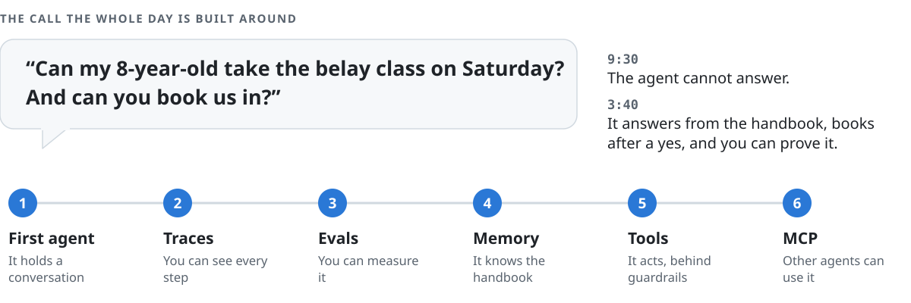
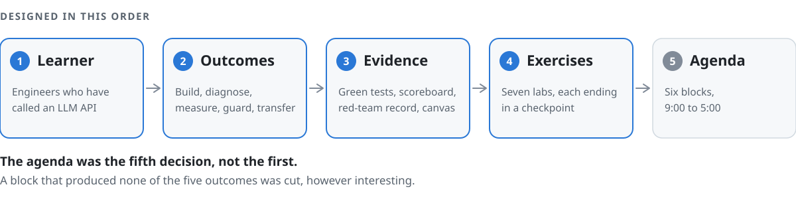
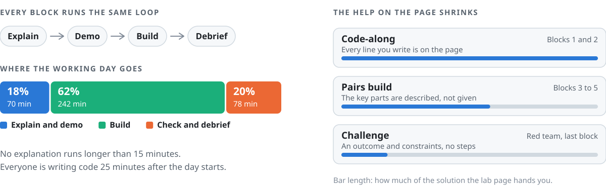
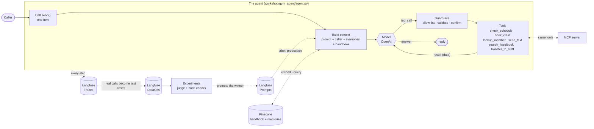
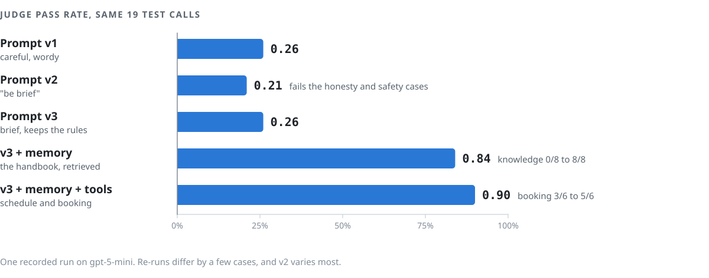

# LLM Agents Workshop

**A one-day, hands-on workshop for software engineers.** In pairs, participants take one AI agent
from a bare model call to a system they can trace, measure and defend, and then they try to break
it. The repository holds everything needed to run the day: starter code, a reference solution,
offline tests, an instructor's run of show and the participant handouts.

[](https://github.com/jasonsheinkopf/LLM-Agents-Workshop/actions/workflows/ci.yml)


<picture>
  <source media="(prefers-color-scheme: dark)" srcset="docs/img/readme/hero-dark.svg">
  
</picture>

| | |
|---|---|
| **For** | Engineers who can read and change Python and have called an LLM API |
| **Format** | One day, instructor-led, working in pairs. The same labs also run self-paced |
| **What gets built** | A front-desk agent for a fictional climbing gym, with tracing, evals, retrieval, memory, tools and guardrails |
| **By the end, each pair can** | [Build, diagnose, measure, guard and transfer](#what-participants-can-do-by-the-end) |
| **Also here** | A [two-hour session for leaders](#the-same-material-for-a-different-audience), built on the same agent |

## Start here — take the workshop

**Want to learn this rather than just browse the project? [Start the guided course →](START_HERE.md).** Clone the repository, read a concept lesson, complete its coding lab, run the checkpoint, and follow the next link. All **seven written lessons** are available now; the videos are optional companions still in development.

[Start learning](START_HERE.md) · [Track progress with local checkboxes](PROGRESS_TEMPLATE.md) · [Teaching guide](docs/FACILITATOR.md)

**On this page:**
[Why it is designed this way](#why-it-is-designed-this-way) ·
[Who it is for](#who-it-is-for) ·
[Outcomes](#what-participants-can-do-by-the-end) ·
[The agent](#the-agent-participants-build) ·
[The day](#the-day) ·
[Assessment](#how-learning-is-assessed) ·
[Evidence](#evidence-from-evaluating-the-example-agent) ·
[Running it](#running-it) ·
[Quick start](#quick-start) ·
[Status](#project-status)

---

## Why it is designed this way

A workshop is judged by what people can do afterward, so this one was designed from that end. The
learner came first, then what they should be able to do, then what would prove it. The labs and
the agenda came last.

<picture>
  <source media="(prefers-color-scheme: dark)" srcset="docs/img/readme/designed-backward-dark.svg">
  
</picture>

Six decisions follow from that. Each one is visible somewhere in the materials.

| Decision | Why | Where it shows |
|---|---|---|
| **Five observable outcomes, fixed first** | A list of topics says what was covered. It does not say what anyone can do | Every block produces one of the five outcomes. Fine-tuning, multi-agent orchestration, agent frameworks and deployment produce none, so they are not in the day |
| **One scenario all day** | Attention spent learning a new example is attention not spent on the idea | The same phone call from 9:15 to 5:00. Each block fixes one thing the previous version of the agent could not do |
| **Mostly building** | The outcomes are things people do, so most of the day is spent doing them | No explanation runs past 15 minutes. About three fifths of the working day is hands-on, and every lab ends at a checkpoint |
| **Failure on purpose** | Agents fail in ordinary use. Finding the layer that failed is the skill | The bare model cannot book. The prompt that feels better breaks two rules. Retrieval misses at `k=1`. The red-team round exists to break the finished agent |
| **Help that shrinks** | Following steps is not the same as being able to do the work | Blocks 1 and 2 are a code-along. From Block 3 the key parts are described, not given. The last two activities have no steps |
| **It ends in the participant's own work** | A good day that changes nothing afterward has not worked | Each pair fills in a canvas for a workflow from their own job, names an owner, and is asked about it thirty days later |

<picture>
  <source media="(prefers-color-scheme: dark)" srcset="docs/img/readme/time-and-help-dark.svg">
  
</picture>

The full reasoning, including what was left out and why, is in [docs/DESIGN.md](docs/DESIGN.md).

## Who it is for

Engineers who have not yet built an agent with tracing, evals and guardrails, and who meet this
bar:

| You need | You do not need |
|---|---|
| To read a Python function and change a few lines of it | Experience with Langfuse, Pinecone or MCP |
| A terminal, git, and a laptop where you can install software | An agent framework. The loop is written by hand, in about twenty lines |
| To have called an LLM API once, or be able to follow a call when shown one | A machine learning background |

It is not a Python course, and it will not work for someone who does not write code. People who
decide where agents get used, and will never build one, need a different session with a different
outcome. It is described [further down](#the-same-material-for-a-different-audience).

**Before the day**, about 25 minutes. The instructor sends [this email](handouts/pre-work-email.md)
a week ahead.

1. **Set up the laptop** with [Lab 0](docs/00-setup.md). It is ready when the doctor command
   prints three PASS lines. This is the one thing that cannot wait until the day.
2. **Bring one workflow** from your own job: something repetitive or decision-heavy.
3. **Answer three questions** about what you have built before, so pairs can be chosen on purpose.

## What participants can do by the end

Each outcome is something you can watch a pair do. The floor is what every pair shows before the
block ends. The stretch is there for pairs who get to the floor early.

| | Outcome | The floor: what every pair shows | The stretch |
|---|---|---|---|
| 1 | **Build** an agent that answers from a handbook and books a class only after the caller confirms | Lab tests pass on their own code, and one booking goes through the confirmation step | A `cancel_booking` tool with its own validation and confirmation, tests first |
| 2 | **Diagnose** a wrong answer from its trace, and name the layer that failed: prompt, knowledge, tool or model | Each person opens one of their own bad traces and says what was missing | That trace becomes a test case |
| 3 | **Measure** a change before shipping it | Two experiments over the same 19 test calls, and a decision about which prompt ships | The judge is calibrated against human grades, and a fourth prompt beats the third |
| 4 | **Guard** the actions that matter in code, where a caller cannot talk past them | In the red-team round: one guardrail that held, named by the file it lives in | A failure becomes a test case, the right layer is fixed, and the experiment is re-run |
| 5 | **Transfer** the pattern to a workflow from their own job | A one-page [workflow canvas](handouts/workflow-canvas.md) with five test cases, an owner and a next step | Another pair reads it and asks the question it does not answer |

## The agent participants build

Ridgeline Climbing Gym is fictional. It wants an AI on the front desk, and a parent calls with one
question that the whole day is built around: *can my 8-year-old take the belay class on Saturday,
and can you book us in?* The right answer needs a policy the model was never trained on (the class
is 12 and up), live data (seats left in the class the child can take) and an action with
consequences (a booking). A bare model has none of the three.

| Block | The agent can now | Built with |
|---|---|---|
| 1 | hold a conversation, following its instructions | OpenAI chat completions |
| 2 | show every step it took: prompts, retrievals, tool calls, tokens, cost, latency | Langfuse tracing |
| 3 | be measured: a test set, a calibrated LLM judge, experiments that compare prompt versions | Langfuse prompts, datasets and experiments |
| 4 | answer from the gym's handbook, and remember a caller between calls | Pinecone and OpenAI embeddings |
| 5 | check the schedule, book a class and send a confirmation, behind guardrails that live in code | OpenAI tool calling and Pydantic |
| 6 | offer the same tools, with the same guardrails, to another agent | MCP (Model Context Protocol) |

**What is real and what is simulated.** The model calls, the traces, the experiments, the vector
index and the MCP server are real: participants use their own OpenAI, Langfuse and Pinecone
accounts. The phone call is a chat in a terminal. A "text message" is recorded and never sent. A
"booking" is a line in a local file. The gym, its handbook and its callers are invented, and phone
numbers use the reserved `555-01xx` range.



The guardrails are code, and the offline tests exercise them: an allow-list of tools, argument
validation, age and seat rules, a step limit, and a booking that only completes on a caller turn
later than the one where the summary was read out. More detail, and the repository layout, in
[docs/ARCHITECTURE.md](docs/ARCHITECTURE.md).

## The day

Six teaching blocks, each with a lab. Lab 0 is setup and happens before the day. Blocks 1 to 6 are
Labs 1 to 6. The red-team round is the second half of Lab 5, and the closing block is Lab 7.

| Time | Block | Explain and demo | Build | Every pair is here before moving on |
|---|---|---:|---:|---|
| 9:00 | Arrive and check | | | The doctor command prints three PASS lines on every laptop |
| 9:15 | **1. First agent** ([Lab 1](labs/01-first-agent/)) | 10 min | 25 min | Tests pass, and they have watched the bare model fail to book |
| 10:00 | **2. Traces** ([Lab 2](labs/02-traces/)) | 10 min | 25 min | One of their own traces is open, and they can point at the missing fact |
| 10:45 | Break | | | |
| 11:00 | **3. Evals** ([Lab 3](labs/03-evals/)) | 15 min | 50 min | Two experiments are on screen, and the room votes which prompt ships |
| 12:15 | Lunch | | | |
| 1:15 | **4. Memory** ([Lab 4](labs/04-memory/)) | 15 min | 50 min | The knowledge score moved in their own re-run |
| 2:30 | Break | | | |
| 2:45 | **5. Tools** ([Lab 5](labs/05-tools/)) | 15 min | 40 min | A booking stops for confirmation and completes on the next message |
| 3:40 | **Red-team round** ([Lab 5, part 2](labs/05-tools/#break-it-the-red-team-round)) | | 15 min | Five hostile inputs tried, and what stopped each one written down |
| 4:00 | **6. MCP** ([Lab 6](labs/06-mcp/)) | 5 min | 12 min | An outside client lists the tools and hits the same confirmation step |
| 4:20 | **Make it yours** ([Lab 7](labs/07-ship-it/)) | | 25 min | A finished workflow canvas, with an owner |
| 4:45 | Demos, exit ticket, close | | | Three pairs demo. Everyone hands in an [exit ticket](handouts/exit-ticket.md) |

Three mechanisms keep a mixed room together:

- **Floor, target, ceiling.** Every lab names the minimum every pair must reach, what most pairs
  finish, and a harder task for pairs who are done early. The instructor protects the floor.
- **A way back in.** `uv run python scripts/catch_up.py 4` puts a pair's code in the state it
  should be in at the start of Lab 4, after backing up what they wrote. Falling behind in one block
  does not cost them the next.
- **Pairs chosen on purpose.** A stronger coder with someone who knows the business process, using
  the answers from the pre-work.

The timings are a design, not a record: this agenda has not yet been run with a room. If it runs
long, the [facilitator guide](docs/FACILITATOR.md) says what to shorten first, and it includes a
3.5-hour variant.

## How learning is assessed

Finishing a guided lab shows that someone can follow steps. The day checks for more than that, in
four ways.

| What is checked | How | When |
|---|---|---|
| **Guided completion** | Offline tests for each lab. They need no keys and cost nothing, so "are you done?" has a yes-or-no answer | Every block |
| **Independent change** | The red-team round has no steps. Every pair tries five hostile inputs and says what stopped each one. Pairs who get further write a failing input into the test set, fix the layer responsible and re-run the experiment | 3:40, and each lab's ceiling |
| **Diagnosis** | Each person explains a failure from its trace and names the layer. In the closing demos, each pair names the failing case they would fix next and where it lives | Every debrief, and the close |
| **Transfer** | The workflow canvas and the [exit ticket](handouts/exit-ticket.md) on the day. One [email at day 30](handouts/follow-up-emails.md) asking what happened to the plan | The close, and afterward |

The workshop itself is meant to be measured the same way: before (the pre-work answers), during
(the checkpoint in every block), at the end (the artifacts and the exit ticket) and thirty days
later. Those instruments are written and ready. They have not been used yet, so there are no
participant results to report.

## Evidence from evaluating the example agent

This is the one place the repository reports measurements. They come from running the reference
agent while building the labs, not from participants.

<picture>
  <source media="(prefers-color-scheme: dark)" srcset="docs/img/readme/scoreboard-dark.svg">
  
</picture>

| Run | Judge pass | Knowledge | Honesty | Safety | Booking |
|---|---:|---:|---:|---:|---:|
| Prompt v1 (careful, wordy) | 0.26 | 0/8 | 2/2 | 1/1 | 1/6 |
| Prompt v2 ("be brief") | 0.21 | 1/8 | 0/2 | 0/1 | 2/6 |
| Prompt v3 (brief, keeps the rules) | 0.26 | 0/8 | 2/2 | 1/1 | 1/6 |
| v3 + memory | 0.84 | 8/8 | 2/2 | 1/1 | 3/6 |
| v3 + memory + tools | 0.90 | 8/8 | 2/2 | 1/1 | 5/6 |

**What it measures.** The same 19 scripted calls go through each version of the agent. Judge pass
is the share of replies an LLM judge accepted: the reply states the required facts and does none
of the forbidden things. A case in the other columns passes when the judge accepts it and a code
check finds the agent booked only when it should have. The judge agreed with a person's grades on
12 of 12 calibration answers. Retrieval, measured separately, returned the right handbook section
in the top three for 15 of 15 questions, and in the top one for 13 of 15.

**What it shows.**

- **The better-sounding prompt broke two rules.** Version 2 was written to fix a real complaint,
  long answers. It was shorter, and with the length it dropped the rules about honesty and safety.
  In a chat window it felt like an improvement. On the test set it failed the safety case in
  every run.
- **No prompt fixed knowledge.** Versions 1 and 3 scored 0 of 8 on knowledge questions in every
  run, because the agent had never seen the handbook. With retrieval it passed 8 of 8.
- **No amount of knowledge fixed booking.** With the handbook the agent knew the rules and still
  could not see live seats or book. Tools moved booking to 5 of 6, from 3 of 6 at best without them.

**What it does not show.** Nineteen cases on one model is enough to catch a broken rule and to
compare versions. It is not evidence that the agent is ready for real callers, and twelve
calibration answers do not establish the judge's accuracy in general.
[Lab 7](labs/07-ship-it/#the-production-checklist) lists what would come before production.

**How stable it is.** The table is one recorded run. Re-running all five versions later, with the
same cases and graders, gave 0.26, 0.37, 0.26, 0.79 and 0.84. Versions 1 and 3 came out identical.
Version 2 is the unstable one: over three runs its overall rate was 0.21, 0.21 and 0.37, because a
prompt with no rules guesses, and some guesses are right. Where it failed did not vary: the safety
case in every run, and at least one of the two honesty cases. That is why the scoreboard is read by
category and not as one average.

The lesson the scoreboard is there to teach is the one participants reach for themselves in Block
3: a change to an agent is a guess until it has been measured.

## Running it

The materials are written so that the day does not depend on one instructor's memory.

| If you want to | Go to |
|---|---|
| Teach it | [docs/FACILITATOR.md](docs/FACILITATOR.md): what to say and demo in each block, the failure to show on purpose, the checkpoint, the debrief questions, and what to do when a third of the laptops fail |
| Understand the design | [docs/DESIGN.md](docs/DESIGN.md) |
| Send and print | [handouts/](handouts/): pre-work email, workflow canvas, exit ticket, follow-up emails |
| Do it on your own | **[Start here](START_HERE.md)**: clone the repo, follow the written lesson → lab sequence, tick an [optional personal progress checklist](PROGRESS_TEMPLATE.md). Budget about five to seven hours plus setup |
| Fix a problem | [docs/TROUBLESHOOTING.md](docs/TROUBLESHOOTING.md) and [docs/FAQ.md](docs/FAQ.md) |
| Look up a term | [docs/GLOSSARY.md](docs/GLOSSARY.md) |

Budget about $2 of OpenAI usage per person for the whole day on the default `gpt-5-mini`. Langfuse
and Pinecone are used on their free plans.

## Quick start

**New here?** The [Start here guide](START_HERE.md) is the recommended entry point. It links every concept lesson to its matching lab and explains how to track your progress in your own clone.

You need Python 3.11 or later, git and a terminal. [Lab 0](docs/00-setup.md) has the full
instructions, including how to get each API key.

```bash
# 1. Get the code and the pinned dependencies (uv installs Python if needed)
git clone https://github.com/jasonsheinkopf/LLM-Agents-Workshop.git
cd LLM-Agents-Workshop
uv sync

# 2. Check the reference solution without any keys: 45 offline tests
uv run pytest --impl solution

# 3. Add your keys, then check they work
cp .env.example .env                  # edit .env (see docs/00-setup.md)
cd workshop
uv run python -m gym_agent.doctor     # three PASS lines means you are ready
cd ..                                # return to the repository root
```

To see the finished agent before building it, run the solution from the repo root:

```bash
cd solution
uv run python -m gym_agent.memory ingest      # load the handbook into Pinecone, once
uv run python -m gym_agent.chat               # call the gym as Dana
```

The work happens in `workshop/`, where each lab fills in a few `TODO(labN)` functions. `solution/`
has the same files finished. `tests/` tells you when a lab is done:

```bash
uv run pytest tests/test_lab1_agent.py     # from the repo root: is Lab 1 done?
uv run python scripts/catch_up.py 4        # behind? start Lab 4 from working code
```

## The same material for a different audience

Leaders who decide where agents are used do not need this day with easier examples. They make
different decisions, so the session was designed again from its outcomes.

| | Engineers | Leaders |
|---|---|---|
| **Their question** | How do I make this reliable? | Where does this belong, who owns it, and what must it never do alone? |
| **Format** | One day, laptops, pairs | Two hours, no laptops, tables of three to five |
| **They do** | Build, trace, test and attack an agent | Vote on three answers, read one trace, score their own workflows, mark where a person must approve |
| **They leave with** | Working code, tests and a scoreboard | One pilot, a named owner and a one-page plan |
| **Evidence it worked** | Tests pass, experiments run, a guardrail held | The plan is signed, and the owner brings evidence to a review thirty days later |

The two sessions share one agent. The leaders' session uses this agent's trace, its scoreboard and
its guardrails as exhibits, so leaders learn to ask for evidence by being shown some. The complete
session, with its run of show and printable handouts, is in [leaders/](leaders/README.md).

## Project status

**Available now.** The starter code and reference solution, seven labs, 45 offline tests that run
in CI, the evaluation set and graders, the facilitator guide, the design notes, the participant
handouts, and the leaders' session with its handouts.

**Available to read.** Seven written [concept lessons](START_HERE.md) adapt the planned video narration and lead directly into the hands-on labs. The course can be completed without video.

**In development.** A six-part companion video series, one episode per technical block. Drafts exist and none are published; the written lessons provide the explanations in the meantime.

**Not claimed.** This workshop has not yet been taught to a cohort. The agenda timings are a
design. There are no participant outcomes, follow-up data or adoption numbers, and the example
agent has not been deployed anywhere.

Built by [Jason Sheinkopf](https://github.com/jasonsheinkopf) with AI coding assistance. The code
is MIT licensed, see [LICENSE](LICENSE). To report a bug or a step that confused you,
[open an issue](https://github.com/jasonsheinkopf/LLM-Agents-Workshop/issues).
