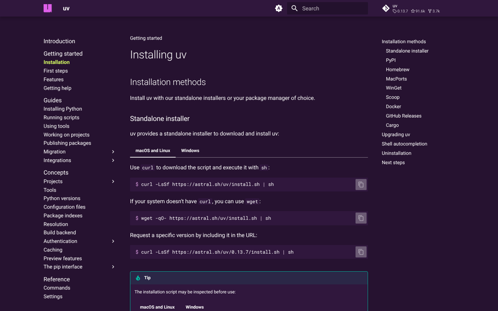
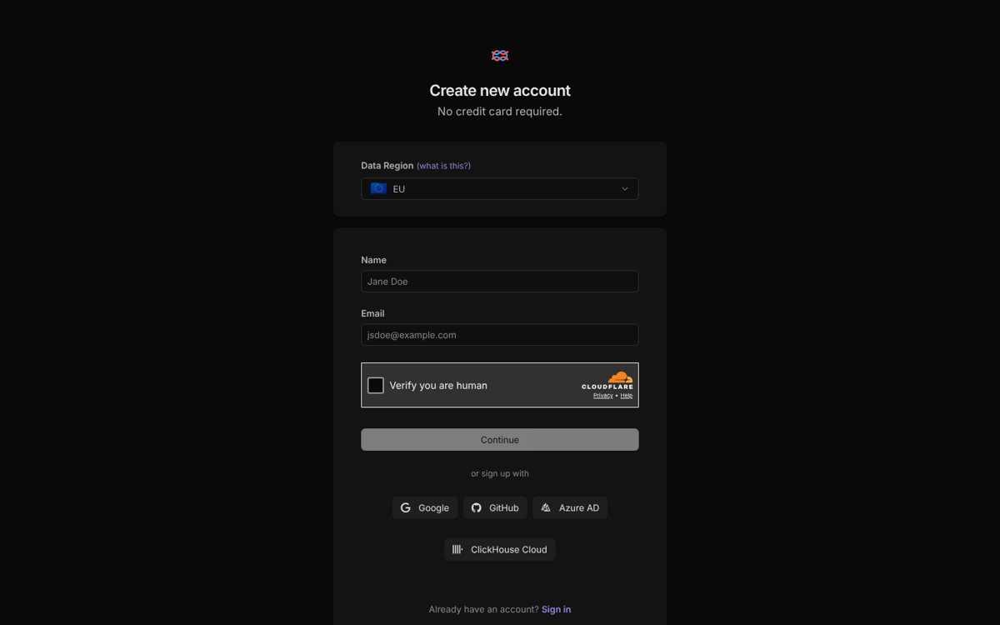
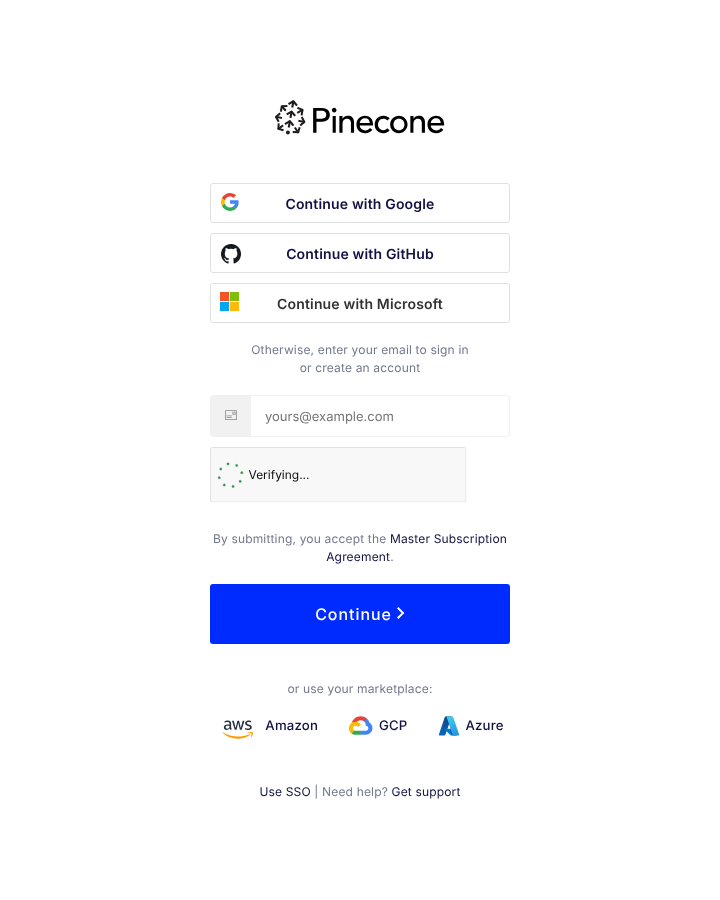

# Lab 0: Setup

**Goal:** by the end of this page, `uv run python -m gym_agent.doctor` prints three green PASS lines.
**Time:** about 20 minutes. **Cost:** free, except OpenAI usage (well under $2 for the whole course).

You'll set up:

| | What | Why | Plan |
|---|---|---|---|
| 1 | **uv** | installs Python and the exact library versions this repo was tested with | free, open source |
| 2 | **OpenAI API key** | the model that talks, the judge that grades, the embeddings for memory | pay as you go |
| 3 | **Langfuse** | traces, prompt versions, datasets, experiments (Labs 2 to 7) | free *Hobby* plan |
| 4 | **Pinecone** | the vector database for long-term memory (Labs 4 to 7) | free *Starter* plan |

> You don't need everything on day one. Lab 1 needs only OpenAI. You can add the Langfuse keys
> before Lab 2 and the Pinecone key before Lab 4. The doctor shows SKIP for anything not set yet.

---

## Step 1: Install uv and get the code

[uv](https://docs.astral.sh/uv/) is a fast Python package and project manager. One tool replaces
`pyenv`, `venv` and `pip`, and it reads the repo's `uv.lock`, so you get exactly the versions the
course was tested with.



**macOS / Linux**

```bash
curl -LsSf https://astral.sh/uv/install.sh | sh
```

**Windows (PowerShell)**

```powershell
powershell -ExecutionPolicy ByPass -c "irm https://astral.sh/uv/install.ps1 | iex"
```

Open a new terminal, then:

```bash
uv --version                     # any recent version is fine
git clone https://github.com/jasonsheinkopf/LLM-Agents-Workshop.git
cd LLM-Agents-Workshop
uv sync                          # creates .venv/ and installs everything from uv.lock
cp .env.example .env             # Windows PowerShell: Copy-Item .env.example .env
```

`uv sync` downloads Python 3.12 automatically if you don't have a suitable version. You never need
to "activate" the environment: `uv run <command>` always uses it.

<details>
<summary>Prefer pip?</summary>

```bash
python -m venv .venv && source .venv/bin/activate     # Windows: .venv\Scripts\activate
pip install openai "langfuse>=5,<6" pinecone "mcp>=2.3,<3" pydantic python-dotenv rich pytest ruff
```

Then drop the `uv run` prefix from every command in the course.
</details>

---

## Step 2: OpenAI API key

1. Sign in at **[platform.openai.com](https://platform.openai.com)**.
2. Add a payment method under **Settings → Billing**. API usage is billed separately from a ChatGPT subscription.
3. **Recommended:** set a monthly budget under **Settings → Limits**, for example $5. The course uses far less.
4. Go to **[API keys](https://platform.openai.com/api-keys)**, then **Create new secret key**. Give it a name such as `llm-agents-workshop`.
5. Copy the key (it starts with `sk-`) into `.env`:

```bash
OPENAI_API_KEY=sk-...
```

The key is shown only once. If you lose it, delete it and make a new one.

**Models used** (change them in `.env` if you like):

| Setting | Default | Used for |
|---|---|---|
| `AGENT_MODEL` | `gpt-5-mini` | the phone agent |
| `JUDGE_MODEL` | `gpt-5-mini` | the LLM-as-a-judge in Lab 3 |
| `EMBEDDING_MODEL` | `text-embedding-3-small` (1536 dims) | turning text into vectors in Lab 4 |

> If your account can't use a default model, set `AGENT_MODEL` and `JUDGE_MODEL` to a model listed
> on your [Limits page](https://platform.openai.com/settings/organization/limits). The doctor tells
> you if the call fails.

---

## Step 3: Langfuse (needed from Lab 2)

[Langfuse](https://langfuse.com) is an open-source LLM engineering platform: tracing, prompt
management, datasets and evals. This course uses **Langfuse Cloud**, which is free for this amount
of usage. You can also [self-host it](https://langfuse.com/self-hosting) with Docker; the code doesn't change.

1. Sign up at **[cloud.langfuse.com](https://cloud.langfuse.com)** (EU region) or
   **[us.cloud.langfuse.com](https://us.cloud.langfuse.com)** (US region). Pick one and remember which.
   

2. Create an **organization**, then a **project**, for example `llm-agents-workshop`.
3. In the project, open **Settings → API Keys → Create new API keys**.
4. Copy all three values into `.env`:

```bash
LANGFUSE_PUBLIC_KEY=pk-lf-...
LANGFUSE_SECRET_KEY=sk-lf-...
LANGFUSE_BASE_URL=https://cloud.langfuse.com      # or https://us.cloud.langfuse.com
```

> **The #1 setup bug:** the keys are valid but `LANGFUSE_BASE_URL` points at the other region. The
> doctor catches this.

---

## Step 4: Pinecone (needed from Lab 4)

[Pinecone](https://www.pinecone.io) is a managed vector database. You'll store the gym handbook's
embeddings there, along with each caller's memories.

1. Sign up at **[app.pinecone.io](https://app.pinecone.io)**. The free **Starter** plan is enough.
   

2. Open **API Keys** in the left sidebar. Copy the default key, or create one.
3. Add it to `.env`:

```bash
PINECONE_API_KEY=pcsk_...
```

You don't create the index by hand. Lab 4's `ingest` command creates a serverless index called
`ridgeline-agent` (1536 dimensions, cosine, `aws` / `us-east-1`, which the free plan supports).

---

## Step 5: Run the doctor

```bash
cd workshop
uv run python -m gym_agent.doctor
```

You want something like:

```
Workshop doctor  (reading /…/LLM-Agents-Workshop/.env)

PASS  Python 3.12.x
PASS  OpenAI: gpt-5-mini replied 'ok'; text-embedding-3-small -> 1536 dims
PASS  Langfuse: authenticated with https://cloud.langfuse.com
PASS  Pinecone: key works; index 'ridgeline-agent' not created yet (Lab 4 creates it)

All set.
```

A FAIL line prints the real error message. The common ones are in
[TROUBLESHOOTING.md](TROUBLESHOOTING.md).

Finally, check that the offline tests run. They need no keys:

```bash
cd ..                               # back to the repo root
uv run pytest --impl solution       # all green: this is the finished agent
uv run pytest tests/test_lab1_agent.py   # red: that's Lab 1's job
```

---

## Editor tips

- Open the **repo root** in your editor (VS Code, Cursor, PyCharm), and pick `.venv/bin/python` as
  the interpreter, so imports resolve.
- Search for `TODO(lab1)` to find your first tasks.
- Keep two panes open: `workshop/gym_agent/<file>.py` on the left, the lab README on the right.

**Next:** [Lab 1: Your first agent →](../labs/01-first-agent/)
