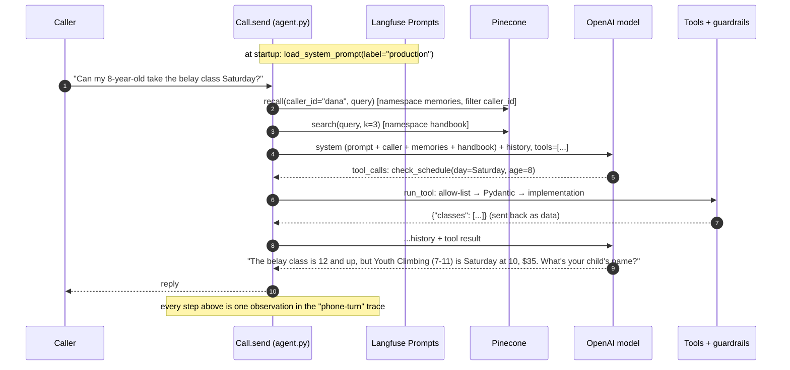

# Architecture

How the finished agent (`solution/gym_agent/`) fits together, and what you'll see in Langfuse and Pinecone.

## One turn, step by step



## Modules

| Module | Responsibility | Lab |
|---|---|---|
| `config.py` | Paths; settings from `.env`; `require()` for friendly missing-key errors | 0 |
| `gym.py` | The fictional business: handbook, schedule, callers, `BookingStore` | 0 |
| `llm.py` | The OpenAI client, Langfuse-wrapped when keys are present | 1, 2 |
| `agent.py` | `GymAgent` (wiring) and `Call` (one phone call: history, context, the loop) | 1–5 |
| `prompts.py` | Fetch the prompt by label, with a file fallback; CLI to push and promote | 3 |
| `evals/` | Dataset upload, graders (code + judge), experiment runner, judge calibration, retrieval eval | 3, 4 |
| `memory.py` | Chunking, embeddings, `PineconeStore` / `InMemoryStore`, `Handbook`, `CallerMemory` | 4 |
| `guardrails.py` | Pydantic argument models (which are also the JSON schemas), `validate_call`, `ToolError` | 5 |
| `tools.py` | Tool descriptions and implementations, `CallContext`, `run_tool` (traced) | 5 |
| `mcp_server.py`, `mcp_client.py` | The same tools over MCP | 6 |
| `chat.py`, `doctor.py` | Terminal chat with feedback scoring; setup checker | 0–7 |

**Design choices worth copying:**
- **Dependency injection.** `GymAgent` takes its client, stores and prompt as arguments. That's
  why the tests can swap in a fake model and an in-memory vector store, and run offline in two seconds.
- **One source of truth for tool contracts.** The Pydantic model *is* the JSON schema the model
  sees *and* the validator your code runs.
- **Features switch on when they're ready.** No Langfuse keys → no tracing (silently).
  No Pinecone index → no memory. The app runs at every stage of the course.
- **Experiments never touch real state.** Each eval case gets a fresh in-memory `BookingStore`, and caller memories are off.

## What a trace looks like (after Lab 5)

```
phone-turn                          agent       session=call-3f9c…  user=dana  tags=[ridgeline-agent]
├── recall_caller_memories          retriever   input: "Can my 8-year-old…"  output: ["Dana's son Sam is 8…"]
│   └── OpenAI-embedding            embedding
├── search_handbook                 retriever   output: [{section: "Youth programs", score: 0.61}, …]
│   └── OpenAI-embedding            embedding
├── OpenAI-generation               generation  prompt: front-desk v3 · 1,840 tokens · $0.0005
├── check_schedule              tool        input: {"day":"Saturday","age":8}  output: {classes: […]}
└── OpenAI-generation               generation  → "Youth Climbing is Saturday at 10…"
scores: user_feedback=1 · (in experiments) judge_pass, fact_recall, booking_policy, tool_use
```

## What's in Pinecone

One serverless index, `ridgeline-agent` (1536 dimensions, cosine), with two namespaces:

| Namespace | Record id | Metadata | Written by | Read with |
|---|---|---|---|---|
| `handbook` | `handbook-waivers` | `section`, `text` | `memory ingest` (idempotent) | `Handbook.search` |
| `memories` | `mem-dana-1a2b3c4d` | `caller_id`, `text`, `created_at` | `Call.end` → `CallerMemory.remember` | `CallerMemory.recall` (**always** filtered by `caller_id`) |

## What's in Langfuse

| Object | Name | Created by |
|---|---|---|
| Prompt | `front-desk` (v1, v2, …; labels `production`, `staging`) | `python -m gym_agent.prompts push` |
| Dataset | `ridgeline-agent-cases` (19 items) | `python -m gym_agent.evals.upload_dataset` |
| Experiment runs | e.g. `langfuse:v3 rag+tools` | `python -m gym_agent.evals.run_experiment` |
| Scores | `user_feedback`, `judge_pass`, `fact_recall`, `booking_policy`, `tool_use`, `avg_*` | chat `/good` `/bad`; experiments |
