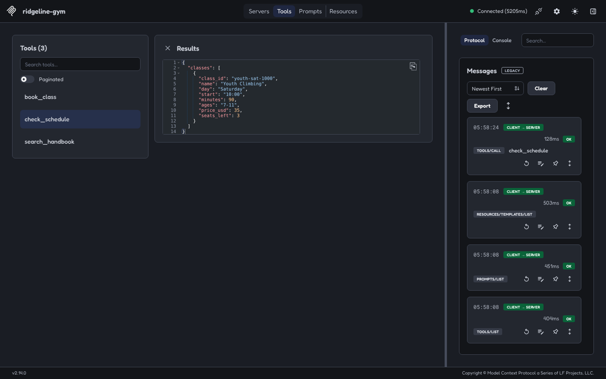

# Lab 6: MCP

**Self-paced reading:** [Read the concept lesson first](../../lessons/06-mcp/README.md), then return here for the coding exercise. [Course map](../../START_HERE.md) · [Checklist](../../PROGRESS_TEMPLATE.md).

**Block 6** · In the room: 5 min explain and demo, 12 min build, 3 min debrief · On your own: about 30 min
**Cost:** free · **Needs:** nothing new (Pinecone optional, for `search_handbook`)

## Goal

Serve Ridgeline's tools over the **Model Context Protocol**, so *any* MCP client can use them:
your own Python client, the MCP Inspector, Claude Desktop, Claude Code, Cursor. You'll write the
server once, and plug it in everywhere, with the same guardrails.

**The failure to look for:** an outside client tries to book. It hits your confirmation step, and an age of 400 is rejected, although the model on the other side is not yours.

**By the end of this lab you can:**
- explain the problem MCP solves (N apps × M tools → N + M);
- write an MCP server whose tools reuse your existing code and guardrails;
- connect to it from code, from the Inspector, and from a desktop AI app.

## Checkpoint

| | You're there when |
|---|---|
| **Floor** (every pair, before the debrief) | `uv run python -m gym_agent.mcp_client` lists your three tools, and its booking comes back asking for confirmation |
| **Target** (most pairs) | You have called a tool from the MCP Inspector, Claude Desktop or Claude Code, and read the validation error for an age of 400 |
| **Ceiling** (if you finish early) | The tasks under [Ceiling](#ceiling-if-you-finish-early), below |

## The idea in two minutes

Without MCP, every app that wants your booking tool wires it in by hand, each with its own format.
With MCP, you publish a **server** that lists its tools (name, description, JSON schema, the
same three things as Lab 5) and runs them on request. Any MCP **client** can discover and call them.

```
Claude Desktop ─┐                        ┌─ check_schedule
Claude Code    ─┼── MCP (stdio or HTTP) ─┤  search_handbook        ← your Lab 4 + 5 code
your agent     ─┤                        └─ book_class (2-step)     ← same guardrails
MCP Inspector  ─┘
```

> This repo uses **MCP Python SDK 2.x**. Older tutorials import `FastMCP` from `mcp.server.fastmcp`.
> In 2.x it's `MCPServer` from `mcp.server.mcpserver`. Same idea, new name.

## What you'll write

File: `workshop/gym_agent/mcp_server.py`. `check_schedule` is done as an example: a decorated
function whose **type hints become the JSON schema** and whose **docstring becomes the description**.

Add the other two tools the same way:

```python
@mcp.tool()
def search_handbook(query: str) -> dict:
    """Search the gym handbook: policies, prices, hours, waivers, parties, safety."""
    return _call("search_handbook", query=query)


@mcp.tool()
def book_class(class_id: str, participant_name: str, participant_age: int,
               confirmation_code: str | None = None) -> dict:
    """Book a class in two steps. First call without confirmation_code to get a summary and a code.
    Show the summary to the user. Only after they confirm in a new message, call again with the code."""
    CTX.turn += 1  # each MCP request is a new step, so a code can't be used in the same request
    return _call("book_class", class_id=class_id, participant_name=participant_name,
                 participant_age=participant_age, confirmation_code=confirmation_code)
```

`_call` goes through the same `run_tool`, which means the same allow-list, Pydantic validation,
business rules and Langfuse tracing as your agent. Note what's **not** an argument: the caller's
identity. It's fixed when the server starts (`RIDGELINE_CALLER_ID`, default `dana`). That's least
privilege again.

```bash
repo $ uv run pytest tests/test_lab6_mcp.py
```

## Run it for real

### 1. From Python

```bash
workshop $ uv run python -m gym_agent.mcp_client
Tools the server offers:
  - check_schedule: List Ridgeline's weekly classes (day, time, ages, price, seats left)...
  - search_handbook: Search the gym handbook: policies, prices, hours, waivers, parties, safety.
  - book_class: Book a class in two steps...

check_schedule(day='Saturday', age=8):
{ "classes": [ { "class_id": "youth-sat-1000", "name": "Youth Climbing", ... "seats_left": 3 } ] }

book_class(...) without a code -> needs confirmation:
{ "status": "needs_confirmation", "summary": "Youth Climbing, Saturday at 10:00, for Sam (age 8), $35.", ... }
```

The client launched the server as a subprocess and talked to it over **stdio**, exactly as desktop apps do.

### 2. In the MCP Inspector (needs Node.js)

```bash
workshop $ npx @modelcontextprotocol/inspector uv run python -m gym_agent.mcp_server
```

A browser tab opens (the terminal also prints the link, with a one-time auth token). Flip the
server's **Connected** switch, open the **Tools** tab, pick `check_schedule`, choose `Saturday`, type
age `8`, and press **Execute Tool**:



Then try `book_class` with an age of 400, and read the validation error.

### 3. In Claude Desktop

Open **Settings → Developer → Edit Config** and add this (use the *absolute* path to your `workshop` folder):

```json
{
  "mcpServers": {
    "ridgeline-gym": {
      "command": "uv",
      "args": ["--directory", "/ABSOLUTE/PATH/TO/LLM-Agents-Workshop/workshop",
               "run", "python", "-m", "gym_agent.mcp_server"]
    }
  }
}
```

Restart Claude Desktop, then ask: *"What classes can an 8-year-old take at Ridgeline on Saturday?
Book one for Sam."* Watch it call your tools, and hit your confirmation step.

> If Claude Desktop can't find `uv`, use its full path (`which uv` on macOS/Linux, `where uv` on Windows).

### 4. In Claude Code

```bash
workshop $ claude mcp add ridgeline-gym -- uv --directory "$PWD" run python -m gym_agent.mcp_server
```

### 5. Over HTTP (optional)

```bash
workshop $ uv run python -m gym_agent.mcp_server --http      # serves http://127.0.0.1:8000/mcp
```

Remote clients connect by URL. To deploy this for real you'd add authentication. The SDK supports
OAuth, and the server constructor takes `auth=` settings.

## What you should notice

- The model on the other side (Claude, in this case) is **not yours**. Your guardrails are the only
  thing that protects your systems, so they *must* live in the server, not in a prompt.
- Good tool descriptions matter even more over MCP: they're the only instructions the other agent gets.

## Debrief

Answer these with your pair before you move on. In a room, the instructor asks pairs for their answers. On your own, write yours down.

1. What happened when the outside client tried to book?
2. Why did the confirmation step still hold, when the model calling it wasn't yours?
3. If you published your workflow's tools to other teams, what would you check first?

## Make it yours

No new row for this block. Reread the **actions** row of your [workflow canvas](../../handouts/workflow-canvas.md): would you let another team's agent call those tools as they stand?

## Ceiling: if you finish early

- Expose the handbook as an MCP **resource** (read-only content) instead of a tool. When is each one right?
- Point your *own* agent at the MCP server instead of calling `run_tool` directly: list the tools, convert them to OpenAI specs, and call them through `Client.call_tool`.

## Stuck?

**Common failures in this lab:**
- `test_mcp_server_lists_and_runs_tools` fails: the three functions must be decorated with `@mcp.tool()` and named exactly `check_schedule`, `search_handbook`, `book_class`.
- The Inspector shows only one tool: the other two aren't decorated, or the server crashed on import (run `uv run python -c "import gym_agent.mcp_server"` to see the error).

`diff workshop/gym_agent/mcp_server.py solution/gym_agent/mcp_server.py` ·
[TROUBLESHOOTING.md](../../docs/TROUBLESHOOTING.md#mcp)

**Out of time for this lab?** `repo $ uv run python scripts/catch_up.py 7` gives you working Lab 6 code, so you start the next block with the room. Your own files are backed up first.

**Next:** [Read the next lesson →](../../lessons/07-transfer/README.md), then follow its link to the lab.
