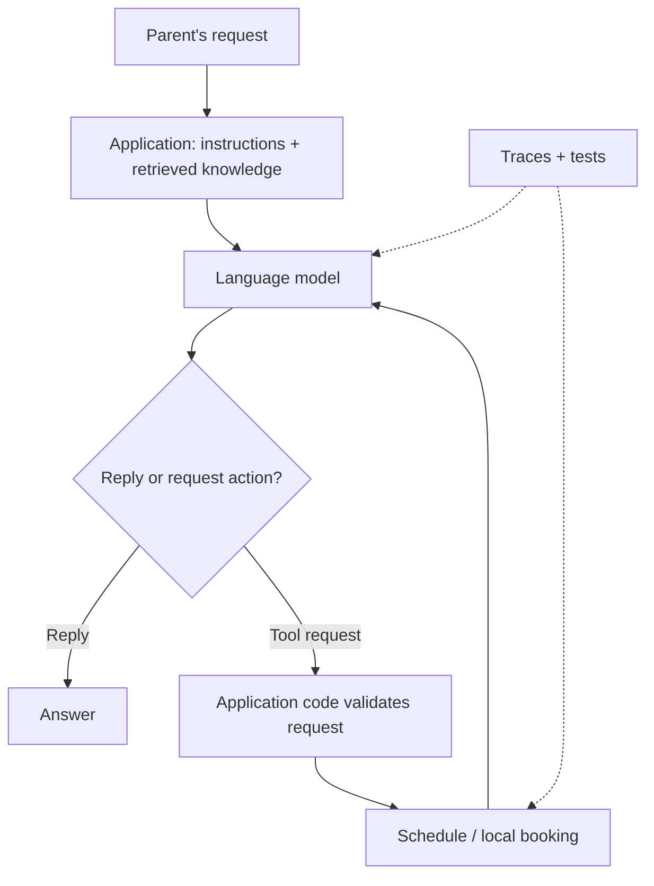

# Lesson 1 — What makes an agent?

**Concept lesson · About 10 minutes · Then [Lab 1: Your first agent](../../labs/01-first-agent/README.md)**

**You will learn:** what a language model does, why a bare model cannot complete a business workflow, and what an agent adds.

## The call that drives this workshop

A parent asks Ridgeline Climbing Gym:

> Can my eight-year-old take the belay class on Saturday? Can you book us in?

A language model can produce a fluent reply, but it hasn't been given Ridgeline's private policies, live class availability, or a way to change the booking system. Three gaps stand between *a plausible answer* and *a completed, trustworthy task*.

| Gap | Without the missing capability | What we'll add |
|---|---|---|
| **Knowledge** | It may invent the age rule; the real belay minimum is 12 | Handbook retrieval (Lesson 4) |
| **Action** | It can say "booked" without changing any record | Tool calls and guarded code (Lesson 5) |
| **Quality evidence** | It sounds confident even when it is wrong | Traces and evaluations (Lessons 2–3) |

## What a model actually does

An LLM generates output token by token from its trained parameters and the context provided in the request. Training and instruction tuning make it useful, but **training isn't a live feed from this fictional gym**. One model API call also does not give the application durable memory between independent requests.

Your first Python call sends an array of messages and receives an assistant message. The application will preserve the conversation and resend relevant history on subsequent turns.

**A prompt is an instruction, not a database or an external action.** “Always be accurate” cannot reveal a handbook the model never saw, and “please book” cannot execute a function that isn't connected.

## What the agent adds

An agentic system can combine a model with context, tools, an execution loop, state, limits and evaluation. **The model proposes; the application decides what it may actually do.** In this course, the "phone" is terminal chat, and the booking is simulated locally.

Later, with the handbook and schedule connected, the same question can be answered correctly: belay is for ages 12+, but youth climbing may fit an eight-year-old. The program must check seats and obtain confirmation before recording a booking.

## Predict the failure before you build

Ask yourself:

1. Why might a bare model confidently invent an age requirement?
2. What happens if the model says “I booked it” but your program has no booking tool?
3. What would you need to observe to tell a real improvement from a convincing demo?

Now **[build Lab 1](../../labs/01-first-agent/README.md)**. Fill in the model call and conversation turn, run the tests, ask it to book, and write down the three gaps you observe.

[Course map](../../START_HERE.md) · [Personal checklist template](../../PROGRESS_TEMPLATE.md)
