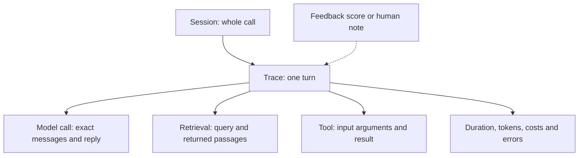

# Lesson 2 — Traces: see what happened

**Concept lesson · About 8 minutes · Then [Lab 2: Traces](../../labs/02-traces/README.md)**

**You will learn:** how tracing exposes intermediate operations and how to diagnose a wrong answer before guessing at a fix.

## “The agent is wrong” doesn't identify the defect

Suppose the agent tells a parent that eight-year-olds can attend the belay class. You know that's false. But did the model ignore the correct handbook? Was the wrong passage retrieved? Did a tool provide stale data? Or was the policy **never supplied**?

The chat transcript shows only the answer. A **trace** lets you inspect the evidence behind it.

## Read a trace like a debugging record

For this workshop, one trace represents **one turn of the simulated call**, and its observations show the operations inside that turn.

- **Trace:** a unit of work with a time span and result.
- **Observation:** a model call, retriever call, tool call, or other nested operation.
- **Session:** related turns in a conversation.
- **Score:** a judgment attached to a trace, such as a thumbs-down, human note or evaluator result.

In Lab 2, Langfuse records the actual model messages. If the system message has no class policy in it, that's a **missing-knowledge problem**. You can stop trying random prompt changes and instead plan to retrieve the handbook.

Later, if you see the wrong passage in the retrieval observation, fix **retrieval**. If the correct policy arrived but the model contradicted it, inspect **instructions and response generation**.

## Turn a failure into a regression test

A useful improvement loop is:

1. Capture the failed caller request and inspect its trace.
2. Describe what a **correct response must and must not do**.
3. Add it to an evaluation dataset.
4. Fix the component implicated by the evidence.
5. Re-run the same case to see whether the failure persists.

Tests that originate in actual failures make future prompt and tool changes less risky. Real-world traces can contain sensitive personal data; don't log or share them indiscriminately. This exercise uses fictional callers.

## Explain it back

- What does the trace reveal that a chat transcript doesn't?
- If the model never received the age policy, is the primary fix a stronger model or supplying the policy?
- What would you trace in an agent for your own workplace?

**Next action:** [Lab 2 — Traces](../../labs/02-traces/README.md). Turn tracing on, inspect the missing policy, attach a score, and answer the debrief.

[Previous: Lab 1](../../labs/01-first-agent/README.md) · [Course map](../../START_HERE.md)
