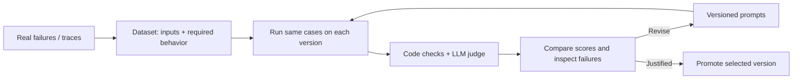

# Lesson 3 — Evals: measure before you ship

**Concept lesson · About 10 minutes · Then [Lab 3: Evals](../../labs/03-evals/README.md)**

**You will learn:** why impressive chats aren't a reliable benchmark, how to compare versions fairly, and how to catch regressions.

## The change that felt better and tested worse

The gym agent is too wordy. You add “be brief” to its prompt. In three quick chats, answers sound better. But some important honesty and safety instructions disappear from its responses.

You improved **one property** and broke another. Without an evaluation, you might ship the regression.

## How to build an evaluation loop

**1. Write test cases.** Capture normal questions, unknown answers, edge cases, and risky requests. Specify the expected *behavior*, not an exact reply string. The course uses **19 demonstration calls**, enough to show the method but not a production-scale benchmark.

**2. Version prompts.** Labels such as `staging` and `production` let an application choose a version and roll back deliberately.

**3. Grade with the right tool.** A deterministic check can verify whether a forbidden tool was called. An LLM judge can assess nuanced natural-language requirements. Neither should be trusted blindly.

**4. Calibrate.** Compare model-judge results against human judgments. This course includes 12 sample human-graded answers; agreement on 12 is a useful exercise, not proof of universal judge accuracy.

**5. Compare the *same* cases.** Separate honesty, safety, knowledge and booking outcomes, and inspect traces when they differ. Generative results can vary across runs.

The recorded example: prompt v1 scored **0.26**, the terse v2 **0.21** with safety and honesty failures, and a corrected v3 recovered the original score. No prompt supplied the missing handbook or tools. Later labs add those and rerun the same tests to show which capability actually improved.

## Try the reasoning before coding

1. Why can't you fairly compare versions if you change the test set between runs?
2. Which quality property might degrade even if a single overall score improves?
3. When is a code assertion preferable to an LLM judge?
4. Write a case where the correct answer is: **“I don't know.”**

**Next action:** [Lab 3 — Evals](../../labs/03-evals/README.md). Upload the test set, write and calibrate graders, compare prompt versions, and decide what should ship.

[Previous: Lab 2](../../labs/02-traces/README.md) · [Course map](../../START_HERE.md)
