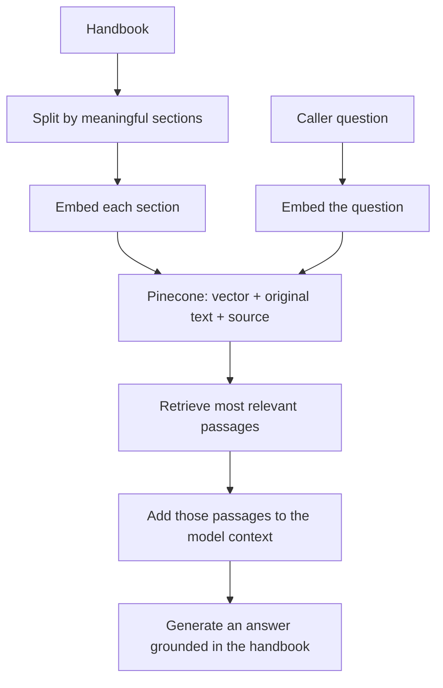

# Lesson 4 — Memory, embeddings and RAG

**Concept lesson · About 10 minutes · Then [Lab 4: Memory](../../labs/04-memory/README.md)**

**You will learn:** how an agent retrieves information it wasn't trained on, how caller memory differs from shared documents, and how to measure retrieval independently.

## A desk and a filing cabinet

Think of an LLM's **context window** as a desk: the model can work with the instructions, conversation, and reference passages placed there for this turn. Space and attention are limited.

A **persistent store** is the filing cabinet next to the desk. The gym handbook and notes from earlier calls can live there between requests. Your application selects the relevant information to put on the desk.

A small handbook could be pasted into every prompt. A larger, frequently updated collection benefits from **retrieval**, so the model receives the relevant passage rather than every document every time.

## How semantic search works

An **embedding** represents text as a vector of numbers. Passages with related meanings can land close together even if the words differ. For example, “Can my babysitter sign?” may retrieve a handbook section about waivers and guardians.

This is **retrieval-augmented generation (RAG)**. You update the source material and its embeddings without retraining the language model.

A relevant-looking passage is not automatically correct or trustworthy. Good implementations identify the source and treat retrieved text as **data, not instructions**.

## Caller memory isn't the handbook

The handbook is shared reference material; the information “Dana's child is eight and they prefer Saturdays” is specific to one caller. The workshop stores and retrieves memories with caller-ID metadata filters.

That filter is an important isolation mechanism. In a real product you'd additionally need verified identities, authorization, retention and deletion policies. Metadata filtering alone is not a complete security model.

## Evaluate retrieval separately

If the correct policy never reaches the context, a perfect response generator cannot use it. Test **hit@k**: did the relevant section appear in the top *k* retrieved results? In the lab you'll see some questions fail when `k=1`.

Compare retrieval scores and **answer** scores. A failure in one layer points to a different fix from a failure in the other.

## Before you code

- Why isn't “paste every document into the prompt” always a good design?
- How does embedding search differ from exact keyword lookup?
- How might one user's memory accidentally appear for another user?
- What should you inspect first when a model fails to cite a handbook rule?

**Next action:** [Lab 4 — Memory](../../labs/04-memory/README.md). Chunk and embed the handbook, add caller-scoped memory, test retrieval, and rerun the evaluation.

[Previous: Lab 3](../../labs/03-evals/README.md) · [Course map](../../START_HERE.md)
