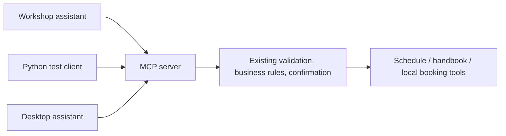

# Lesson 6 — MCP: one tool, many AI clients

**Concept lesson · About 8 minutes · Then [Lab 6: MCP](../../labs/06-mcp/README.md)**

**You will learn:** what Model Context Protocol standardizes, how another agent can use the gym's tools, and what security still belongs in the server.

## What problem does MCP solve?

You built tool functions for your own gym assistant. Now imagine a coding assistant, a desktop chat client, or another agent wants to check the same schedule. Without a shared protocol, each app needs its own custom integration.

**MCP provides a standard way for clients to discover tools and call them through a server.** The server advertises schemas and descriptions; the client chooses a tool and sends arguments.

The business logic can be the same Python functions already built in Lab 5.

## The actual flow

1. A client connects to the MCP server.
2. The server lists available tool names, descriptions and argument schemas.
3. The client calls `check_schedule` with a day.
4. Your server runs the code and returns the result.
5. If a client requests `book_class`, your server still validates the input and enforces confirmation.

A model on the other side is **not your model**. That is precisely why important rules need to live in the service executing the action.

MCP itself is not an automatic permission boundary or a substitute for authentication. The lab is a local demonstration; internet-facing deployment would need identity checks, access control, auditing and protection against untrusted clients.

## Your turn

- What does MCP standardize that previously needed custom glue?
- If the external model ignores your recommended prompt, which constraints still hold?
- What would you add before exposing this server to real customers?

**Next action:** [Lab 6 — MCP](../../labs/06-mcp/README.md). Serve the existing tools, connect an independent client, and verify that validation still works.

[Previous: Lab 5](../../labs/05-tools/README.md) · [Course map](../../START_HERE.md)
