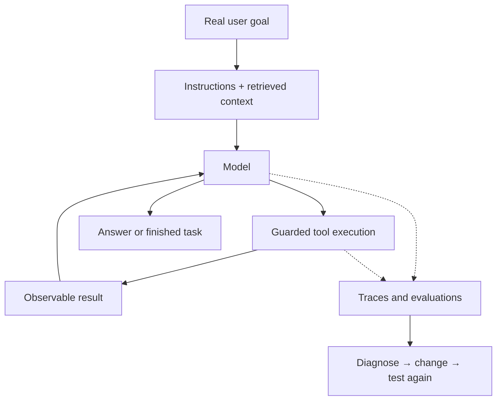

# Lesson 7 — From the gym to your own work

**Capstone reading · About 8 minutes · Then [Lab 7: Make it yours](../../labs/07-ship-it/README.md)**

**You will learn:** how to translate the example into a safe, measurable workplace proposal, and why a working demonstration is not the same as a deployable system.

## Put the whole agent together

An agent combines a model with instructions, appropriate knowledge, tool access, state, and an execution loop. Observability and evaluations let you investigate what happened and compare changes.

When something breaks, **find the responsible layer**, change it, and measure again. A more enthusiastic prompt cannot supply missing company data; a better retriever cannot replace permission checks for risky actions.

## An independent changed-requirement check

Guided lab completion can mean you followed the instructions correctly. To test transfer, give yourself an unfamiliar condition before looking at the solution:

> New Ridgeline requirement: if the handbook doesn't state who may sign a particular type of waiver, the agent must say it cannot verify that permission and offer escalation. It must not invent an exception.

Without copying an existing example, write two ordinary and one tricky caller scenario with expected behaviors. Decide whether handbook data, a prompt, tool logic, or a test case needs to change. Make a **small change**, then run the affected tests or experiment and inspect a trace. Describe what passed, what failed, and what the small test set cannot prove.

The goal isn't another elaborate feature. It's evidence you can **adapt what you built**.

## Plan for workplace transfer

Complete the [workflow canvas](../../handouts/workflow-canvas.md):

| Decision | Questions to answer |
|---|---|
| Goal | Who needs help? What starts the task? What observable result counts as success? |
| Knowledge | What documents or records does it need? Who keeps them current? |
| Actions | Which tools can it use? Which actions need human approval? |
| Evidence | What five test cases—including a failure case—would you run? |
| Ownership | Who tries the first safe pilot, when, and with what metric? |

The gym assistant remains a **teaching prototype**, not a production telephone service. Real deployment would require authentication, operational monitoring, rate limits, data-handling policies, broader evaluations, and protection against duplicate actions.

## The 30-day question

What did someone actually use? What changed in their workflow? If the experiment stalled, what blocked it? An impressive demo is not the same as improved work.

**Finish here:** [Lab 7 — Make it yours](../../labs/07-ship-it/README.md). Complete the canvas, then tick your local [progress checklist](../../PROGRESS_TEMPLATE.md).

[Previous: Lab 6](../../labs/06-mcp/README.md) · [Course map](../../START_HERE.md)
